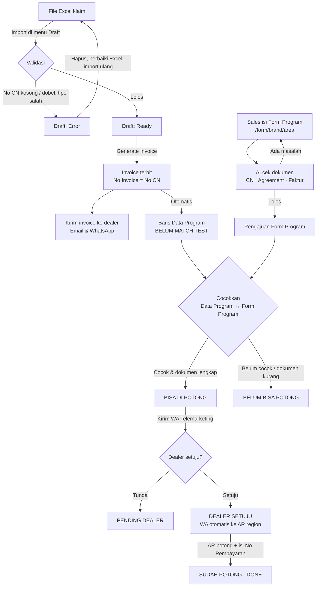
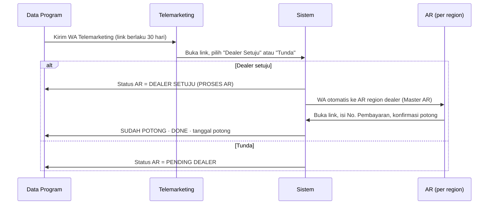

# SCM — Supply Chain Management

Aplikasi web untuk mengelola klaim program Realme dari awal sampai selesai: impor draft dari Excel, terbitkan invoice, kirim invoice ke dealer, terima pengajuan klaim dari sales lewat Form Program, cocokkan dengan Data Program, lalu konfirmasi pemotongan lewat WhatsApp ke Telemarketing dan AR.

Dibangun dengan **Laravel 13 (PHP 8.3+)**, **Vue 3** (SPA) dan **Tailwind CSS v4**. Semua data dipisah per area: **Jawa Barat** dan **Jawa Tengah**.

---

## Daftar Isi

- [Gambaran Umum](#gambaran-umum)
- [Alur Kerja Lengkap](#alur-kerja-lengkap)
  - [1. Draft → Invoice](#1-draft--invoice)
  - [2. Pengiriman Invoice](#2-pengiriman-invoice)
  - [3. Data Program](#3-data-program)
  - [4. Form Program (pengajuan sales)](#4-form-program-pengajuan-sales)
  - [5. Pencocokan Data Program ↔ Form Program](#5-pencocokan-data-program--form-program)
  - [6. Konfirmasi Telemarketing & AR](#6-konfirmasi-telemarketing--ar)
  - [7. Akun & Hak Akses](#7-akun--hak-akses)
- [Panduan Per Menu](#panduan-per-menu)
- [Aturan Bisnis Penting](#aturan-bisnis-penting)
- [Instalasi & Setup Lokal](#instalasi--setup-lokal)
- [Konfigurasi `.env`](#konfigurasi-env)
- [Perintah Artisan & Scheduler](#perintah-artisan--scheduler)
- [Deploy ke Production](#deploy-ke-production)
- [Testing](#testing)
- [Struktur Data](#struktur-data)
- [Troubleshooting](#troubleshooting)

---

## Gambaran Umum

| Modul | Fungsi |
| :--- | :--- |
| **Draft** | Impor file Excel klaim (DSA / NPS FL / REGULAR), validasi rumus pajak, lalu terbitkan jadi invoice. |
| **Invoice** | Daftar invoice resmi: lihat, cetak/unduh PDF, kirim lewat email (Gmail API / SMTP) dan WhatsApp. |
| **Form Program** | Formulir publik untuk sales (mis. `/form/realme/jabar`) mengirim dokumen klaim (Credit Note, Agreement, Faktur Pajak). Dokumen dicek AI. |
| **Data Program** | Daftar klaim (56 kolom) per area. Baris otomatis dibuat saat invoice terbit, lalu dicocokkan dengan Form Program. |
| **Riwayat** | Riwayat Program (log pencocokan), Riwayat Approval (alur persetujuan telemarketing & AR), Riwayat Email, dan Dashboard ringkasan. |
| **Master** | Brand, Program, Region, AR, Dealer, Badan Usaha (Bill To), User. Bisa import & export Excel. |
| **Profil** | Ubah foto, nama, email, WhatsApp, dan password akun sendiri. |

**Brand & area.** Data dikelompokkan per **brand** (Realme, Oppo, ... dari **Master → Brand**) lalu per **area** (Jawa Barat / Jawa Tengah):

- **Per brand & area:** Draft, Invoice, Form Program, Data Program, dan Riwayat Program. URL-nya `/<menu>/<brand>/<area>`, mis. `/data-program/realme/jabar`. Di menu atas, klik Draft / Invoice / Form Program / Data Program, pilih brand, lalu pilih area. Di halamannya juga ada tab brand dan tab area.
- **Per brand:** Master Program (tiap brand punya kode program sendiri).
- **Per area (dipakai semua brand):** Dealer, Region, dan AR.
- **Dipakai bersama:** Badan Usaha dan User.

Data lama dan link lama (`/form/jabar`, `/data-program/jabar`, dst.) otomatis milik / diarahkan ke **Realme**.

---

## Alur Kerja Lengkap



### 1. Draft → Invoice

1. Buka **Draft**, pilih tab area, klik **Import Excel**, lalu unggah file `.xlsx`, `.xls`, atau `.csv`.
   - Baris header dikenali otomatis. Kolom yang dibaca, sesuai urutan standar: No, Region, RSM, Dealer Code, Kode BT, Nama Cust, Dealer Name, Realqty, NPWP, Nama NPWP, Jenis NPWP, Jenis PPh, Support Amount, DPP, DPP Lain, PPN, PPh, Netpay, Kode Item, Nama Item, Alamat, Email, WhatsApp, Nama Program, Periode Program, **No CN**, Tanggal Inv, Refnote, DSA/NPS FL.
   - **Tipe invoice** diisi dari kolom DSA/NPS FL. Kalau kosong, dipakai *Tipe Invoice Default* yang dipilih saat import.
   - **Area draft mengikuti tokonya di Master Dealer.** Toko Jawa Tengah yang diimport dari tab Jawa Barat otomatis masuk tab Jawa Tengah.
2. Sistem menghitung ulang DPP, DPP Lain, PPN, PPh, dan Net Pay dari Support Amount (lihat [rumus](#perhitungan-pajak)) lalu membandingkannya dengan angka di Excel. Status draft:
   - **Ready**: siap diterbitkan.
   - **Error**: ada masalah, misalnya No CN kosong atau sudah dipakai, atau tipe invoice tidak dikenal. Draft error tidak bisa diedit; hapus, perbaiki Excel, lalu import ulang.
3. Klik **Generate** per baris, **Generate (n) Terpilih**, atau **Generate Semua Invoice**, lalu pilih **Bill To** (badan usaha dari Master Badan Usaha, mis. CV TOP SELULAR).
4. **Nomor invoice = No CN** dari Excel. No CN wajib diisi dan unik di semua area. Invoice yang sudah terbit otomatis dibuatkan baris **Data Program** di area yang sama.
5. Draft bisa juga dibuat manual lewat **Tambah Manual** (No CN tetap wajib).

### 2. Pengiriman Invoice

- **Email.** Kalau akun Google Workspace sudah terhubung (badge "Gmail: …" di halaman Invoice, klik untuk menghubungkan), email dikirim lewat **Gmail API** dari akun pengirim yang dipilih (daftar di tabel `email_accounts`). Kalau belum terhubung, email dikirim lewat **SMTP** (`MAIL_*`).
- **WhatsApp.** Invoice PDF dikirim lewat WA Gateway (`WAG_*`) ke nomor WhatsApp dealer.
- **Cara kirim:** per baris, centang beberapa lalu **Kirim (n)**, atau **Kirim Semua**. Invoice yang sudah terkirim ditandai **Terkirim** dan tidak ikut terkirim ulang.
- Semua pengiriman tercatat di **Riwayat → Riwayat Email**.

### 3. Data Program

- Setiap invoice yang terbit menjadi satu baris Data Program. Baris ini membawa kode program, periode, NPWP, nominal, telemarketing, dan sales dari **Master Dealer** toko tersebut.
- Status awal: **Cek Dokumen = BELUM MATCH TEST**, **Status Potong Purchase = BELUM BISA POTONG**.
- Kolom **No PO**, **No PO/SJ**, dan **No SJ** bisa diisi langsung di tabel seperti spreadsheet:
  - pilih sel, klik dua kali, atau langsung ketik
  - **Enter** menyimpan
  - tarik kotak kecil di pojok sel ke bawah untuk mengisi baris berikutnya (angka bertambah otomatis; tahan **Ctrl** untuk menyalin apa adanya)
- Kolom lain diubah lewat tombol **Edit**.
- **Integrasi Google Spreadsheet** (opsional, per area): menu **Spreadsheet** untuk sinkron dari sheet atau mengirim perubahan ke sheet lewat Google Apps Script Web App. Baca [peringatan sinkron](#deploy-ke-production) sebelum memakai sinkron otomatis.

### 4. Form Program (pengajuan sales)

Formulir publik tanpa login:

| Brand & area | URL |
| :--- | :--- |
| Realme Jawa Barat | `/form/realme/jabar` (link lama `/form/jabar`, `/form-submission` & `/form-realme` diarahkan ke sini) |
| Realme Jawa Tengah | `/form/realme/jateng` |
| Brand lain | `/form/<kode-brand>/jabar` · `/form/<kode-brand>/jateng` (kode brand terlihat di Master Brand) |

1. Sales memilih toko di **ID REALME** (pertanyaan pertama), dicari dengan kode BT, ID Realme (ID GS), atau nama toko. Toko hanya bisa dipilih dari Master Dealer (tidak bisa diketik manual); toko yang belum ada harus ditambahkan admin dulu. Nama dealer, region, nomor WA, status PKP, dan agreement toko terisi otomatis.
2. Sales memilih **Nama Program** (dari Master Program brand tersebut).
3. Isi Nama Sales, lalu unggah dokumen:
   - **Credit Note (CN)**: wajib.
   - **Agreement**: satu agreement bertanda tangan per toko, berlaku untuk semua program. Di form **Realme**, kalau toko sudah punya agreement di **Master Dealer**, kolom ini terisi otomatis dan tidak perlu diunggah (link-nya tidak ditampilkan di form publik). Agreement yang diunggah sales menggantikan agreement toko di Master Dealer. Toko yang belum punya agreement wajib mengunggah. Agreement tidak dianalisis AI.
   - **Faktur Pajak**: **wajib untuk toko PKP**, tidak wajib untuk Non-PKP. Status PKP diambil dari **Jenis NPWP di Master Dealer** dan ditampilkan di formulir.
4. Saat **Kirim**, dokumen dianalisis AI. AI membaca nama dealer, program, DPP, PPN, PPh, dan Net Pay di CN, lalu memeriksa kelengkapan dan dokumen yang tertukar.
   - Kalau ada masalah (dokumen kurang, nama dealer/program berbeda, file tertukar), hasilnya ditampilkan di kartu **Hasil Pemeriksaan Dokumen** dan formulir belum terkirim.
   - Kalau AI tidak tersedia, sistem memakai **model cadangan** lalu **pembacaan cadangan tanpa AI**.
5. Dokumen disimpan di object storage S3 (`AWS_*`). Pengajuan masuk ke menu **Form Program** di area yang sama.

### 5. Pencocokan Data Program ↔ Form Program

Jalankan dengan **Cocokkan Test Program** di Data Program (semua baris atau per baris lewat **Lihat → Uji Ulang**). Sebuah pengajuan Form Program dianggap cocok dengan baris Data Program bila **semua** syarat ini terpenuhi:

| Syarat | Keterangan |
| :--- | :--- |
| Area | Harus sama (Jabar tidak dicocokkan dengan Jateng). |
| Region | Sama setelah dinormalisasi ("BANDUNG" = "BIG BANDUNG"). |
| Kode BT / ID Realme | ID REALME di form sama dengan **Kode BT atau ID GS** baris Data Program ("BTO…" = "BT0…"). |
| Nama dealer | Sama atau sangat mirip. |
| Nama program | Sama atau mengandung kata kunci yang sama. |
| Nominal | Net Pay / DPP sama (toleransi kecil). Kalau beda: **SELISIH NOMINAL**. |

Hasil pencocokan:

- **Cocok + dokumen lengkap:** Cek Dokumen **LENGKAP**, Status Potong **BISA DI POTONG**. Link CN, Agreement, dan Faktur disalin ke Data Program.
- **Cocok, dokumen kurang:** mis. **FAKTUR BELUM ADA** untuk toko PKP.
- **Tidak cocok:** tetap **BELUM MATCH TEST**.

Setiap pencocokan dicatat di **Riwayat → Riwayat Program**.

### 6. Konfirmasi Telemarketing & AR



- **Otomatis:** cron `program:auto-match` jalan **setiap menit** dan mencocokkan baris Data Program yang belum bisa dipotong dengan Form Program-nya, tanpa mengirim WA. Baris tanpa pengajuan, atau yang tidak berubah sejak dicek, dilewati. WA ke telemarketing toko dikirim terpisah oleh cron `program:notify-telemarketing` pada jam yang diatur di **Master → Jadwal Otomatis** (bawaan 09:00 dan 14:00 WIB): semua baris **BISA DI POTONG** yang belum dikirimi, sekali per baris. Waktu kirimnya tampil di tombol WA dan di **Lihat**.
- **Pengingat:** selama dealer belum setuju (belum dijawab, atau ditunda), cron yang sama mengirim ulang WA berjudul *PENGINGAT KE-n* ke telemarketing dengan link konfirmasi baru. Bawaannya **3 hari setelah WA terakhir, paling banyak 3 kali**; bisa diubah atau dimatikan di **Master → Jadwal Otomatis → Pengingat** (1–7 hari, 1–5 kali). Baris yang baru ditunda menunggu jarak yang sama sejak ditunda. Hanya WA yang benar-benar terkirim (tercatat di **Riwayat Approval**) yang diingatkan, jadi baris lama yang cuma ditandai terkirim saat WA otomatis dipasang tidak ikut. Setiap pengingat tercatat di Riwayat Approval.
- **Manual:** tombol **WA** / **Kirim ke WA Telemarketing** muncul di Data Program untuk baris **BISA DI POTONG**. Nomor tujuan diambil dari telemarketing toko di Master Dealer (bisa dipilih ulang saat mengirim). Baris yang sudah dikirim manual tidak dikirim ulang oleh cron.
- **AR tujuan** dicari dari **Master AR** berdasarkan region dealer (Region, lalu Big Region). Kalau region belum punya AR aktif, WA dikirim ke nomor AR default (`AR_DEFAULT_PHONE`).
- Link konfirmasi ditandatangani (*signed URL*) dan kedaluwarsa 30 hari setelah dikirim.
- Setiap langkah dicatat di **Riwayat → Riwayat Approval**: WA ke telemarketing (otomatis atau oleh siapa), dealer setuju / tunda (lewat link telemarketing), WA ke AR (berhasil atau gagal), dan sudah dipotong (lewat link AR, dengan No. Pembayaran), beserta waktunya.

### 7. Akun & Hak Akses

- **Daftar:** `/register` (nama, email, WhatsApp, peran, password). Akun baru berstatus **Menunggu ACC** sampai disetujui admin di **Master → User**.
- **Masuk:** `/login` dengan username/email + password, atau **Masuk dengan WhatsApp** (kode OTP dikirim ke nomor WA terdaftar). Setelah masuk, pengguna dibawa ke halaman yang tadi dibuka atau ke Dashboard.
- **Peran:**

  | Peran | Akses bawaan |
  | :--- | :--- |
  | Admin, SCM | Semua menu |
  | AR | Draft, Invoice, Riwayat Email, Dashboard, Riwayat Program |
  | Telemarketing | Form Program, Riwayat Program |

  Admin bisa mengatur akses per menu untuk tiap user di **Master → User**.
- **Profil:** klik lingkaran inisial/foto di kanan atas → **Profil** untuk ganti foto, nama, email, WhatsApp, dan password. Menu yang sama berisi **Mode Gelap** dan **Keluar**.

---

## Panduan Per Menu

### Draft
- Tab area, **Generate Semua / Import / Tambah Manual**, filter wilayah & program, pencarian.
- Aksi per baris: lihat detail, Generate (Ready), Validasi ulang (Error), buka Invoice (Invoiced), kirim ulang ke Data Program, Hapus (belum jadi invoice).
- Detail draft menampilkan perbandingan nilai Excel vs hitungan sistem.

### Invoice
- Pilih beberapa invoice lalu **Kirim (n)**, atau **Kirim Semua**.
- Per baris: **Lihat** (detail), **PDF**, **Kirim** (email + WA).
- Pratinjau cetak publik: `/invoices/{id}/preview`; unduh PDF: `/invoices/{id}/pdf`.

### Form Program (admin)
- Daftar pengajuan per area. **Lihat** membuka *Detail Finansial & Pajak* (Incentive, DPP, PPN, PPh, Net Pay, dll.) dan tombol **Analisis AI Ulang**.
- Menu **Aksi**: buka formulir publik area ini, buka spreadsheet, atur integrasi sheet, refresh data.

### Data Program
- **Lihat**: hasil uji kecocokan per baris (Data Program vs Form Program), **Uji Ulang**, **Riwayat**, **Kirim ke WA Telemarketing**.
- **Edit**: ubah semua kolom baris.
- No PO / No PO/SJ / No SJ: isi langsung di tabel seperti spreadsheet.
- **Cocokkan Test Program**: cocokkan semua baris sekaligus.

### Riwayat
- **Riwayat Program**: log pencocokan (Sesuai, Dokumen Kurang, Selisih, Belum Ada Form) dengan nominal dan dokumen.
- **Riwayat Approval** (per brand & area, ikut hak akses Riwayat Program): tiap baris Data Program yang sudah **BISA DI POTONG** tampil dengan alur 5 langkah: *Bisa dipotong → WA ke telemarketing → Disetujui dealer → WA ke AR → Sudah dipotong*. Langkah selesai berwarna hijau, posisi sekarang kuning, WA yang gagal merah, dan "Ditunda dealer" oranye. Filter per tahap (Belum dikirim ke telemarketing, Menunggu persetujuan dealer, Ditunda dealer, Disetujui · proses AR, Sudah dipotong) beserta jumlahnya, dan pencarian dealer / kode BT / program / telemarketing. **Detail** menampilkan waktu, pelaku, tujuan WA, dan catatan tiap langkah. Tahap diambil dari status Data Program, jadi baris lama ikut tampil; hanya waktu & pelaku langkah sebelum fitur ini dipasang yang tidak tercatat.
- **Riwayat Email**: log pengiriman invoice.
- **Dashboard**: ringkasan jumlah draft, invoice per tipe, dan total Net Pay.

### Master
| Menu | Isi | Import / Export |
| :--- | :--- | :--- |
| **Brand** | Brand program (Realme, Oppo, ...): nama, kode URL (dibuat otomatis, tidak berubah), urutan, status. Brand aktif muncul di menu Draft, Invoice, Form Program, dan Data Program. Brand yang sudah punya data tidak bisa dihapus, cukup dinonaktifkan. | — |
| **Program** | Kode program (mis. PROGRAM 345), nama, periode. Satu daftar per brand untuk semua area (tab brand di atas halaman). Nama program di draft otomatis mengisi kodenya. | Import & export Excel (kolom PROGRAM, NAMA PROGRAM, PERIODE) |
| **Region** | Region per area (dipakai di Form Program & Master Dealer). | Export |
| **AR** | AR per region: nama & nomor WhatsApp penerima WA "dealer setuju dipotong". | Export |
| **Dealer** | Toko dari file Master Customer CV TOP: kode BT, nama, alias, ID Realme/Nama GS, Jenis NPWP, NPWP, region, telemarketing (+ nomor WA), sales, status. Kolom **Agreement** (link dokumen agreement toko) diisi dari Form Program atau diedit manual, dan tetap ada walau dealer diimport ulang. Daftar bisa difilter **Ada / Belum ada agreement** (ikut ke Export). Di file export, agreement ada di kolom terakhir **Agreement** sebagai teks pendek **Link AGR** yang bisa diklik (kolom ini diabaikan saat import). | Import (file CV TOP; satu file untuk semua area) & export dengan format yang sama |
| **Badan Usaha** | Badan usaha Bill To invoice (CV TOP SELULAR, PT RISM, PT MSI, ...): kode, nama, NPWP, alamat. Dulu bernama Master Customer; link lama `/customers` diarahkan ke `/badan-usaha`. | Export |
| **User** | Akun pengguna, peran, akses per menu, persetujuan (ACC). | — |
| **Reset Data** | Khusus Admin. Hapus data transaksi (Draft, Invoice, Data Program, Form Program) dan/atau data master (Dealer, Region, AR, Program, Badan Usaha) yang dipilih, untuk area dan brand tertentu atau semuanya. Brand, user, dan jadwal tidak pernah ikut terhapus. | — |

**Import Master Dealer:** tombol **Import Excel** menerima dua jenis file dan mengenalinya otomatis. Import berjalan **di background**: jendela langsung tertutup, lalu status, progres, dan hasilnya tampil di atas daftar Master Dealer (halaman boleh ditinggal). Hanya satu import yang bisa berjalan pada satu waktu.

- **Master Customer CV TOP** (data toko): area tiap toko diambil dari kolom **Big Area** (atau **Reffnote** bila Big Area kosong). Toko tanpa keduanya dilewati dan bisa diunduh sebagai daftar *dealer belum diimport*. Pilih **Tambah & perbarui** (aman) atau **Ganti semua** (hapus semua dealer lama di kedua area). File lain ditolak dari baris header-nya, tanpa memuat seluruh file.
- **Draft Program** (agreement toko): file dengan sheet berkolom **Kode BT** & **AGREMENT** (mis. RAW JABAR). Sama dengan `dealers:fill-agreements "<file>"`: tiap agreement dicek AI, jadi bisa butuh beberapa menit; progresnya tampil per toko. Import data toko CV TOP dulu bila Master Dealer masih kosong.

Import di background dijalankan antrean (queue). Lokal: `composer run dev` sudah menjalankannya. Server: cukup cron scheduler, karena scheduler menjalankan `queue:work --stop-when-empty` setiap menit (import mulai paling lambat sekitar satu menit setelah diunggah).

> File export Dealer hanya berisi area yang sedang dibuka. Jangan mengimport file satu area dengan pilihan **Ganti semua**, karena dealer area lain akan terhapus.

**Reset Data:** pilih area (semua / Jawa Barat / Jawa Tengah), brand (semua atau satu brand), dan data yang mau dihapus, klik **Reset data**, lalu masukkan **password reset**. Untuk data master, pilihan area/brand berlaku sesuai datanya: Dealer, Region, dan AR per **area**; Program per **brand** (semua area); Badan Usaha selalu **semua**. Reset Dealer ikut menghapus link agreement toko; isi lagi lewat Import Excel CV TOP lalu `dealers:fill-agreements`. Password ini diatur Admin di halaman yang sama (**Atur/Ubah password reset**; mengubahnya butuh password lama) dan disimpan sebagai hash di tabel `app_settings`. Selama belum diatur, reset tidak bisa dipakai. Salah password dibatasi 5 kali per menit. Penghapusan tidak bisa dibatalkan dan dicatat di `storage/logs/laravel.log` beserta email admin-nya.

- **Draft:** invoice dari draft itu ikut terhapus.
- **Invoice:** riwayat email & WA-nya ikut terhapus; draft-nya kembali berstatus siap sehingga bisa di-generate lagi.
- **Data Program / Form Program:** riwayat pencocokannya ikut terhapus. Baris yang masih ada di Google Spreadsheet akan masuk lagi saat sinkron berikutnya, jadi kosongkan juga spreadsheet-nya bila datanya memang tidak dipakai lagi.
- File yang sudah diunggah (dokumen Form Program, PDF invoice) tidak dihapus.

---

## Aturan Bisnis Penting

### Nomor invoice
Nomor invoice selalu sama dengan **No CN** di draft. No CN wajib dan tidak boleh dipakai dua kali, termasuk antar area. Draft dengan No CN kosong atau dobel ditandai Error saat import dan ditolak saat generate.

### Perhitungan pajak
Dihitung dari **Support Amount** (nilai bruto, sama dengan **Incentive** di Data Program):

| Kolom | Rumus |
| :--- | :--- |
| DPP | Support Amount ÷ 1,11 (Jenis PPh **BONUS**: DPP = Support Amount) |
| DPP Lain | DPP × 11/12 — **hanya** BADAN / PKP; selain itu 0 |
| PPN | DPP Lain × 12% |
| PPh | DPP × tarif PPh: BADAN / BADAN NON 2%, PRIBADI 2,5%, BONUS 15% |
| Net Pay | DPP + PPN − PPh |

Contoh PRIBADI dengan Support 500.000: DPP 450.450, PPN 0, PPh 11.261, **Net Pay 439.189**.

### PKP & Faktur Pajak
Kewajiban Faktur Pajak mengikuti **Jenis NPWP di Master Dealer**:

| Jenis NPWP | Faktur Pajak |
| :--- | :--- |
| BADAN, PRIBADI PKP | **Wajib** |
| PRIBADI, NON, BADAN NON | Tidak wajib |
| Kosong / tidak dikenal (mis. BONUS) | Ditebak dari dokumen: wajib bila CN mencantumkan PPN |

### Kode BT & ID Realme
- Kode BT disimpan dengan angka nol: "BTO5768" ditulis "BT05768", kecuali "BT0…" sudah dipakai toko lain.
- ID Realme (ID GS) boleh dipakai beberapa toko. Pencarian dan pencocokan memakai kode BT dulu, lalu ID Realme + nama dealer.

---

## Instalasi & Setup Lokal

### Prasyarat
- PHP **8.3+** dengan ekstensi `gd`, `zip`, `mbstring`, `pdo_mysql`
- Composer 2
- Node.js 20+ & NPM
- MySQL 8 (SQLite dipakai untuk test)
- (Opsional) [Laravel Herd](https://herd.laravel.com/) untuk Windows/macOS

### Langkah

```bash
git clone https://github.com/oceanspacedev/Automation-SCM.git
cd Automation-SCM

composer install
npm install

cp .env.example .env
php artisan key:generate
```

Isi koneksi database dan layanan lain di `.env` (lihat [Konfigurasi `.env`](#konfigurasi-env)), lalu:

```bash
php artisan migrate --seed      # tabel + akun admin + akun email pengirim
php artisan db:seed --class=MasterDataSeeder      # badan usaha Bill To (CV TOP, PT RISM, PT MSI)
php artisan db:seed --class=MasterProgramSeeder   # master program
php artisan storage:link        # foto profil & PDF invoice di storage/app/public
```

Jalankan aplikasi:

```bash
composer run dev                # server Laravel, queue, scheduler, dan Vite sekaligus
```

atau di terminal terpisah:

```bash
php artisan serve
npm run dev
php artisan schedule:work       # wajib agar Jadwal Otomatis jalan
```

Buka `http://localhost:8000`. Akun bawaan dari seeder:

| Email | Password |
| :--- | :--- |
| `admin@scm.com` | `password` |

> Segera ganti password akun bawaan lewat menu **Profil**, terutama di production.

Isi Master Dealer pertama kali lewat **Master → Dealer → Import Excel**, atau lewat terminal:

```bash
php artisan dealers:import "Master Customer CV TOP.xlsx"            # ganti semua dealer
php artisan dealers:import "Master Customer CV TOP.xlsx" --keep-existing
```

---

## Konfigurasi `.env`

| Variabel | Kegunaan |
| :--- | :--- |
| `APP_URL` | URL aplikasi (dipakai untuk link konfirmasi WA, PDF, dan foto). |
| `DB_*` | Koneksi MySQL. |
| `MAIL_*` | SMTP cadangan bila Gmail API belum terhubung. |
| `GOOGLE_CLIENT_ID`, `GOOGLE_CLIENT_SECRET`, `GOOGLE_REDIRECT_URI` | OAuth Google Workspace untuk kirim invoice lewat Gmail API (`/auth/google/callback`). |
| `WAG_URL`, `WAG_TOKEN`, `WAG_VERIFY_SSL` | WhatsApp Gateway (kirim invoice, OTP login, WA telemarketing & AR). |
| `WAG_PUBLIC_URL` | Alamat publik untuk link di pesan WA (link PDF & konfirmasi). Kosongkan untuk memakai `APP_URL`. |
| `AR_DEFAULT_PHONE` | Nomor AR cadangan bila region belum punya AR di Master AR. |
| `TELEMARKETING_DEFAULT_PHONE` | Nomor telemarketing cadangan bila baris Data Program tidak punya nomor. |
| `OPENAI_COMPATIBLE_BASE_URL`, `OPENAI_COMPATIBLE_API_KEY`, `OPENAI_COMPATIBLE_MODEL` | AI router (API kompatibel OpenAI) untuk membaca dokumen Form Program. |
| `OPENAI_COMPATIBLE_FALLBACK_MODEL` | Model cadangan bila model utama error (bawaan `ag/gemini-3-flash`). |
| `AWS_ACCESS_KEY_ID`, `AWS_SECRET_ACCESS_KEY`, `AWS_BUCKET`, `AWS_ENDPOINT`, `AWS_URL`, `AWS_USE_PATH_STYLE_ENDPOINT` | Object storage S3 untuk dokumen Form Program. |
| `DATA_PROGRAM_SPREADSHEET_URL`, `DATA_PROGRAM_WEBAPP_URL` | Spreadsheet & Apps Script Web App Data Program Jawa Barat (opsional). |
| `PROGRAM_SUBMISSION_SPREADSHEET_URL`, `GOOGLE_SHEET_WEBAPP_URL` | Spreadsheet & Apps Script Web App Form Program Jawa Barat (opsional). |

Link spreadsheet per area (termasuk Jawa Tengah) juga bisa diatur langsung dari aplikasi lewat menu **Spreadsheet** / **Aksi**; pengaturan dari aplikasi menimpa nilai `.env`.
| `ENABLE_AUTO_SYNC_SCHEDULE` | `true` untuk menyalakan sinkron Data Program terjadwal di lingkungan `local`. |
| `ENABLE_AUTO_AI_SCHEDULE` | `true` untuk menyalakan analisis AI terjadwal di lingkungan `local`. |
| `AUTO_MATCH_SEND_WA` | `false` mematikan WA ke telemarketing dari cron `program:notify-telemarketing`, apa pun pengaturan di Master Jadwal Otomatis (bawaan `true`). |

Jangan pernah commit nilai rahasia (`*_KEY`, `*_SECRET`, `*_TOKEN`, password) ke repository.

---

## Perintah Artisan & Scheduler

| Perintah | Fungsi |
| :--- | :--- |
| `php artisan dealers:import "<file>" [--keep-existing]` | Import Master Dealer dari file CV TOP. Baris yang dilewati disimpan di `storage/app/dealer-import/dealer-belum-diimport.xlsx`. |
| `php artisan data-program:sync [--limit=0]` | Sinkron Data Program dari Google Spreadsheet. |
| `php artisan program:auto-analyze-ai --year=2026 --limit=15` | Analisis AI pengajuan Form Program yang belum dianalisis. |
| `php artisan program:refresh-completeness` | Perbarui status kelengkapan pengajuan Non-PKP. |
| `php artisan dealers:fill-agreements` | Isi agreement Master Dealer dari agreement terbaru yang pernah dikirim toko lewat Form Program Realme. Toko yang sudah punya agreement tidak diubah. Jalankan sekali setelah fitur agreement dipasang (aman dijalankan ulang). |
| `php artisan dealers:fill-agreements "<file Data Program>.xlsx" [--sheet="RAW JABAR"] [--parallel=8]` | Isi agreement Master Dealer dari kolom **AGREMENT** file Data Program (mis. *DRAFT TEMPLATE PROGRAM JABAR*), dicocokkan lewat **Kode BT**. Isi tiap dokumen dicek AI (AI router yang sama dengan cek CN/Faktur; file Word dibaca dari teks & gambarnya). Yang dipakai: link **terbaru** toko itu yang berupa agreement dan **nama tokonya terisi**. Agreement dengan nama toko kosong hanya dipakai bila ada **tanda tangan dan cap yang namanya sesuai toko itu** di Master Dealer (tanda tangan saja tidak cukup). Credit Note, invoice, faktur, dan agreement yang tidak memenuhi dilewati, lalu link yang lebih lama dicoba. Bila tidak ada yang memenuhi, agreement dari file dihapus dari toko itu. Agreement yang tidak ada di file (mis. dari Form Program) tidak diubah. Hasil cek AI disimpan per file, jadi menjalankan ulang hanya mengecek dokumen baru atau yang gagal dicek. |
| `php artisan program:auto-match [--limit=200]` | Cocokkan Data Program dengan Form Program (tanpa WA). |
| `php artisan program:notify-telemarketing [--limit=200]` | WA ke telemarketing untuk baris yang BISA DI POTONG dan belum pernah dikirimi, lalu pengingat untuk baris yang belum disetujui dealer (sesuai pengaturan **Pengingat** di Master Jadwal Otomatis). |

Di luar lingkungan `local`, `data-program:sync` dan `program:auto-analyze-ai` dijadwalkan **setiap menit**. `program:auto-match` juga jalan **setiap menit**, di semua lingkungan, begitu pula `queue:work --stop-when-empty` yang menjalankan antrean (mis. import Master Dealer dari web) lalu berhenti. `program:notify-telemarketing` mengikuti **Master → Jadwal Otomatis**: aktif/nonaktif, pada jam tertentu (WIB, bawaan 09:00 dan 14:00) atau setiap 5 menit sampai 6 jam, di hari yang dipilih. Di halaman itu juga ada tombol **Jalankan sekarang** dan hasil jalan terakhir.

Semua jadwal di atas hanya jalan bila **scheduler Laravel** berjalan. `php artisan serve` dan `queue:work` saja tidak cukup.

- **Lokal:** `composer run dev` sudah ikut menjalankan scheduler (proses `scheduler`). Bila server dan queue dijalankan terpisah, buka satu terminal lagi untuk `php artisan schedule:work` dan biarkan terbuka.
- **Server:** pasang cron:

```cron
* * * * * cd /path/ke/aplikasi && php artisan schedule:run >> /dev/null 2>&1
```

Scheduler mencatat detak setiap menit. Bila detak terakhir lebih dari 2 menit lalu, **Master → Jadwal Otomatis** menampilkan peringatan *Scheduler belum berjalan*. Setelah scheduler dinyalakan, tunggu sekitar satu menit lalu klik **Periksa lagi**.

---

## Deploy ke Production

1. `composer install --no-dev --optimize-autoloader`
2. `npm ci && npm run build`
3. `php artisan migrate --force`, lalu sekali saja `php artisan dealers:fill-agreements` untuk mengisi agreement Master Dealer dari pengajuan yang sudah ada
4. `php artisan storage:link` (sekali saja)
5. `php artisan config:cache && php artisan route:cache && php artisan view:cache`
6. Pastikan `storage/` dan `bootstrap/cache/` bisa ditulis web server.
7. Pasang cron scheduler (lihat di atas). Wajib untuk import Master Dealer dari web (dijalankan antrean lewat scheduler), sinkron spreadsheet, dan analisis AI otomatis.

**Agar import Master Dealer di background jalan di server:**

- `.env`: `QUEUE_CONNECTION=database` (bukan `sync`, yang membuat import kembali berjalan di dalam request dan bisa timeout) dan `CACHE_STORE=database` (atau `file`/`redis`, asal sama untuk web dan antrean; tempat status import disimpan). Jangan isi `DB_QUEUE_RETRY_AFTER` di bawah `3700`.
- Batas unggah minimal 50 MB (file Draft Program ±20 MB): PHP `upload_max_filesize = 50M`, `post_max_size = 50M`; Nginx `client_max_body_size 50m;`.
- PHP CLI boleh menjalankan proses lain (`proc_open` tidak ada di `disable_functions`): scheduler dan cek AI agreement menjalankan beberapa proses `php artisan` sekaligus.
- `storage/` bisa ditulis: file unggahan disimpan sementara di `storage/app/private/dealer-import` sampai import selesai.
- Opsional: queue worker tetap (mis. Supervisor `php artisan queue:work --tries=1 --timeout=3600`) supaya import mulai seketika, bukan menunggu menit berikutnya. Setelah deploy kode baru, jalankan `php artisan queue:restart`.
- AI router harus aktif (sama dengan cek CN/Faktur). Import agreement pertama di server mengecek semua dokumen (±800 toko, link lama ikut dicek bila perlu), jadi bisa 15–30 menit dan memakai kuota AI; import berikutnya hanya mengecek dokumen baru.

> **Peringatan sinkron spreadsheet.** Sinkron penuh `data-program:sync` menganggap Google Spreadsheet sebagai sumber utama dan **menghapus baris Data Program yang tidak ada di sheet**, termasuk baris yang dibuat dari invoice di web. Kalau data sudah dikelola penuh di web, jangan nyalakan scheduler sinkron (atau matikan jadwalnya di `routes/console.php`).

---

## Testing

```bash
php artisan test --compact
php artisan test --compact tests/Feature/DataProgramTest.php     # satu file
php artisan test --compact --filter=test_nama_test               # satu test
```

Test memakai SQLite in-memory dan memalsukan HTTP (AI, WhatsApp, Google). Kalau server S3 di `.env` tidak bisa dijangkau dari komputer lokal, arahkan ke alamat kosong saat test, misalnya di PowerShell:

```powershell
$env:AWS_ENDPOINT='http://127.0.0.1:9'; php artisan test --compact
```

Format kode PHP dengan Pint sebelum commit:

```bash
vendor/bin/pint --dirty
```

---

## Struktur Data

| Tabel | Isi |
| :--- | :--- |
| `users` | Akun, peran, akses per menu, status ACC, WhatsApp, foto profil. |
| `drafts` | Baris hasil import Excel (per area), status Ready/Error/Invoiced, catatan validasi. |
| `invoices` | Invoice resmi (per area, nomor = No CN), nominal, status kirim email & WA, path PDF. |
| `data_programs` | Klaim 56 kolom per area (dari invoice atau spreadsheet), status potong & dokumen. |
| `program_submissions` | Pengajuan Form Program per area, link dokumen, hasil analisis AI. |
| `program_reconciliation_logs` | Log setiap pencocokan Data Program ↔ Form Program. |
| `program_approval_logs` | Langkah alur approval per baris Data Program: WA ke telemarketing, pengingat, setuju / tunda, WA ke AR, sudah dipotong (waktu, pelaku, tujuan WA, catatan). Ikut terhapus bila baris Data Program-nya dihapus. |
| `dealers` | Master Dealer per area (kode BT unik). |
| `regions` | Master Region per area. |
| `ar_contacts` | Master AR per region per area. |
| `brands` | Master Brand (Realme, Oppo, ...); kode URL-nya dipakai di kolom `brand` tabel data. |
| `master_programs` | Master Program per brand (kode unik per brand, dipakai semua area). |
| `app_settings` | Pengaturan yang diubah dari aplikasi, mis. hash password Reset Data. |
| `customers` | Master Badan Usaha (Bill To invoice). |
| `automation_schedules` | Master Jadwal Otomatis: kapan tugas otomatis (WA ke telemarketing) berjalan, pengaturan pengingatnya (`options`), dan hasil jalan terakhirnya. |
| `email_accounts` | Akun pengirim email invoice. |
| `email_logs`, `whatsapp_logs` | Log pengiriman invoice. |

---

## Troubleshooting

| Masalah | Solusi |
| :--- | :--- |
| `Unable to locate file in Vite manifest` / tampilan tidak berubah | Jalankan `npm run dev` (development) atau `npm run build` (production), lalu refresh. |
| Foto profil / PDF tidak tampil | Jalankan `php artisan storage:link` dan pastikan `APP_URL` benar. |
| Analisis dokumen hasilnya aneh (DPP kosong, nama dealer salah) | AI router sedang error, sehingga yang dipakai pembacaan cadangan. Cek `storage/logs/laravel.log` ("AI vision call … returned HTTP …"), ganti model di `.env`, lalu klik **Analisis AI Ulang**. |
| WA tidak terkirim | Cek `WAG_URL` dan `WAG_TOKEN`, serta nomor tujuan (format 08… / 628…). |
| Jadwal Otomatis tidak pernah jalan / muncul peringatan *Scheduler belum berjalan* | Scheduler Laravel mati. Jalankan `php artisan schedule:work` (lokal) atau pasang cron `php artisan schedule:run` (server). Lihat [Perintah Artisan & Scheduler](#perintah-artisan--scheduler). |
| Email invoice gagal | Hubungkan ulang Google Workspace dari halaman Invoice, atau cek `MAIL_*`. |
| Data Program tidak cocok padahal datanya sama | Pastikan area, region, nama dealer, nama program, dan nominal sama; ID REALME di form harus kode BT atau ID GS toko yang sama. Lihat detail di **Data Program → Lihat**. |
| Import draft banyak yang Error | Biasanya No CN kosong atau sudah dipakai, atau tipe invoice tidak dikenal. Lihat pesan per baris di hasil import. |

---

Hak Cipta © 2026 SCM. Dilindungi undang-undang.
